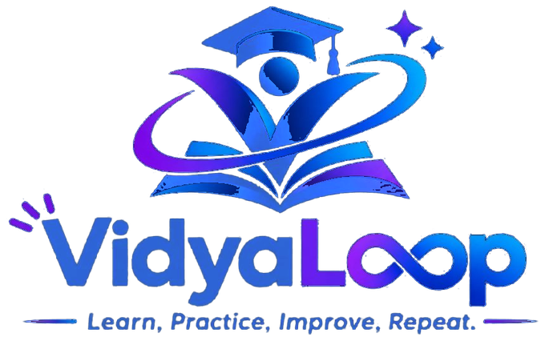
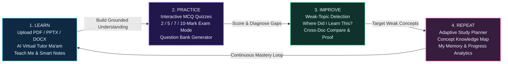
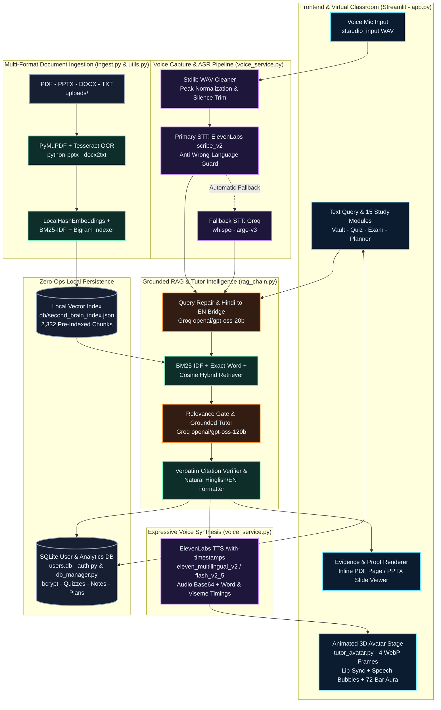
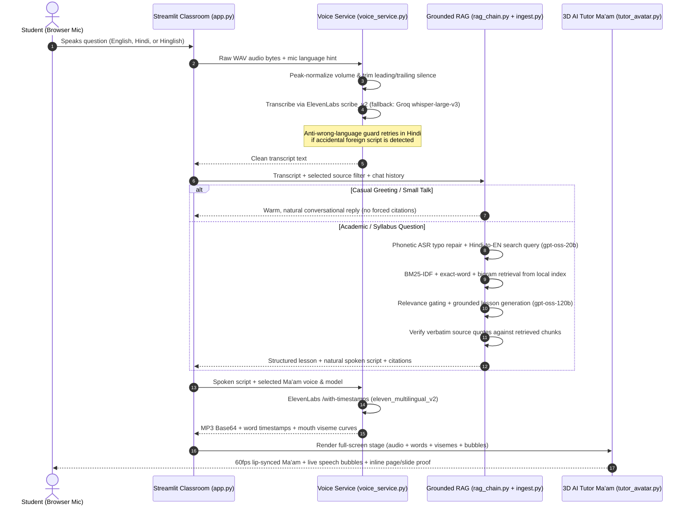

<div align="center">



<h1>VidyaLoop</h1>

<p><strong><em>Learn, Practice, Improve, Repeat.</em></strong></p>

<p>
  An interactive, voice-enabled <strong>AI Virtual Classroom &amp; Evidence-Grounded RAG Study Suite</strong><br/>
  that transforms your PDFs, PowerPoint decks (<code>.pptx</code>), Word docs, and notes into a natural bilingual AI teacher.
</p>

<p>
  
  
  
  
  
  
  
</p>

<p>
  <a href="#problem-solution">Problem &amp; Solution</a> &nbsp;&bull;&nbsp;
  <a href="#ai-virtual-tutor">AI Virtual Tutor</a> &nbsp;&bull;&nbsp;
  <a href="#learning-cycle">Learning Loop</a> &nbsp;&bull;&nbsp;
  <a href="#system-architecture">Architecture</a> &nbsp;&bull;&nbsp;
  <a href="#voice-pipeline">Voice Flow</a> &nbsp;&bull;&nbsp;
  <a href="#study-suite">15-Module Suite</a> &nbsp;&bull;&nbsp;
  <a href="#benchmarks">Benchmarks</a> &nbsp;&bull;&nbsp;
  <a href="#quick-start">Quick Start</a> &nbsp;&bull;&nbsp;
  <a href="#team-genx-ai">Team GenX AI</a>
</p>

</div>

---

## 🌟 Executive Overview

Students today juggle hundreds of pages across lecture PDFs, PowerPoint slides, scanned handouts, and scattered revision notes. Generic AI chatbots frequently **hallucinate outside the syllabus**, speak in **walls of silent, overly technical text**, struggle with **Indian English & Hinglish voice queries**, and provide **no closed-loop practice or mastery tracking**.

**VidyaLoop** closes that gap end-to-end. Upload your course material once—VidyaLoop indexes every page and slide locally into a fast **BM25-IDF hybrid vector store**, pairs it with a **borderless animated 3D AI Virtual Tutor (Ma'am)** powered by **ElevenLabs** and **Groq**, verifies every answer against **verbatim source quotes with 1-click page/slide previews**, and guides learners through a continuous **Learn → Practice → Improve → Repeat** cycle.

---

<a id="ai-virtual-tutor"></a>
## 👩‍🏫 AI Virtual Tutor (Ma'am)

<table>
  <tr>
    <td width="310" align="center" valign="middle">
      
      <br/>
      <sub><em>Borderless 3D AI Teacher seamlessly blended onto the dark classroom stage</em></sub>
    </td>
    <td valign="top">
      <h3>Interactive Voice-to-Voice Classroom</h3>
      <ul>
        <li><strong>Continuous Alpha-Blended Lip-Sync:</strong> 4 pixel-locked feathered WebP frames (<code>idle</code>, <code>blink</code>, <code>mid</code>, <code>open</code>) driven at 60fps by ElevenLabs character/viseme timestamps—zero frame pop, zero torso wobble, organic breathing, and 175ms sine-eased natural blinking.</li>
        <li><strong>Real-Time Speech-Bubble Captions:</strong> Floating student &amp; teacher dialogue bubbles highlight words in sync with Ma'am's voice alongside a 72-bar reactive audio aura.</li>
        <li><strong>Natural Bilingual Teaching (English &amp; Hinglish):</strong> Speak in English, Hindi, or natural Hinglish—Ma'am detects your language automatically and explains concepts simply with human pauses, warm pacing, and zero robotic jargon.</li>
        <li><strong>4 Selectable Teacher Personas:</strong> Switch instantly between <code>Ms. Sarah</code> (default), <code>Ms. Jessica</code>, <code>Prof. Bella</code>, and <code>Prof. Alice</code>, or toggle <code>Multilingual v2</code> (expressive human voice) and <code>Flash v2.5</code> (ultra-low latency).</li>
        <li><strong>Session History &amp; Instant Replay:</strong> Revisit past Q&amp;As in the top-right History drawer and replay cached audio lessons with zero extra API calls.</li>
        <li><strong>Evidence-Backed Slide &amp; Page Previews:</strong> Every syllabus lesson includes verified verbatim quotes and inline rendered PDF pages or PowerPoint slides.</li>
      </ul>
    </td>
  </tr>
</table>

---

<a id="problem-solution"></a>
## 🎯 The Problem & Our Solution

| Dimension | ❌ Traditional Studying & Generic Chatbots | ✅ VidyaLoop (*Learn, Practice, Improve, Repeat.*) |
| :--- | :--- | :--- |
| **Syllabus Accuracy** | Generic LLMs hallucinate facts or answer outside university curricula without proof. | **Strict Evidence-Grounded RAG** with verbatim quote verification, relevance gating, and inline PDF page / PPTX slide previews. |
| **Student Experience** | Passive reading of dense 200-page PDFs or silent walls of AI text. | **Full-screen Animated AI Tutor (Ma'am)** with expressive voice narration, real-time lip-sync, and conversational speech bubbles. |
| **Voice & Language Barrier** | Speech recognition breaks on Indian accents, quiet mics, and Hindi-English code-switching. | **WAV Peak Normalization + ElevenLabs Scribe v2** with anti-wrong-language guard, phonetic ASR repair, and **Hindi-to-English RAG search bridge**. |
| **Multi-Format Notes** | Most tools only handle plain text or basic PDFs, ignoring slide decks and scanned notes. | Native ingestion for **PDF (digital + Tesseract OCR fallback), PowerPoint (`.pptx`), Word (`.docx`), and `.txt`** files. |
| **Closed-Loop Retention** | Answering one question gives no insight into weak topics or exam readiness. | Integrated **Interactive Quizzes, 2/5/7/10-Mark Exam Mode, Weak-Topic Detection, Knowledge Maps, Smart Notes & Study Planner** saved per user in SQLite. |
| **Zero-Friction Deployment** | Heavy external vector DBs (Pinecone/Chroma servers) break free-tier hosting. | **100% self-contained local JSON BM25-IDF vector index + SQLite**—runs locally or deploys in 1 click on **Render Free Tier** (`render.yaml`). |

---

<a id="learning-cycle"></a>
## 🔁 The VidyaLoop Learning Cycle



---

<a id="system-architecture"></a>
## 🏗️ System Architecture



---

<a id="voice-pipeline"></a>
## 🎙️ Voice-to-Voice Pipeline

Every voice turn passes through a resilient, latency-optimized pipeline engineered specifically for real student microphones and bilingual English/Hinglish speech:



---

<a id="study-suite"></a>
## 📚 15-Module Study Suite

VidyaLoop ships as a unified learning workspace with **15 interactive views** persisted per authenticated student account:

| # | Module | Purpose & Key Capabilities |
| :-: | :--- | :--- |
| **1** | **👩‍🏫 AI Virtual Tutor** | Full-screen borderless animated AI teacher (Ma'am) with voice-to-voice mic, natural English/Hinglish replies, real-time speech-bubble captions, 4 personas, cached History Replay, and inline source page/slide previews. |
| **2** | **🏠 Student Dashboard** | Live telemetry of questions asked, quizzes completed, average score, weak topics, saved memories, active study plan progress, and recent learning activity. |
| **3** | **💬 Ask VidyaLoop** | Multi-turn grounded RAG chat across all or selected documents with verbatim quote verification, source citations, and instant document previews. |
| **4** | **📍 Where Did I Learn This?** | Reverse-lookup any concept across your entire uploaded library to pinpoint exact document names, page/slide numbers, matching excerpts, and rendered visual previews. |
| **5** | **🎓 Teach Me Mode** | Step-by-step conceptual breakdowns tailored to beginner, intermediate, or exam-ready clarity with optional ElevenLabs voice playback. |
| **6** | **🎯 Exam Mode** | Generates structured university **2-mark, 5-mark, 7-mark, and 10-mark** answers grounded in your syllabus with marking-scheme bullet clarity and voice narration. |
| **7** | **🧪 Interactive Quiz** | Document-grounded MCQ assessments with instant grading, per-question explanations, source references, automatic **weak-topic tracking**, and score history. |
| **8** | **❓ Question Generator** | Creates curated short-answer, conceptual, and long-answer practice question banks directly from uploaded chapters or decks. |
| **9** | **📝 Smart Notes** | Distills lengthy PDFs and PowerPoint decks into crisp revision sheets, definitions, key takeaways, and bulleted summaries. |
| **10** | **⚖️ Compare Documents** | Side-by-side structured comparison across two or more uploaded sources to highlight similarities, differences, and overlapping concepts. |
| **11** | **🗺️ Knowledge Map** | Extracts a structured concept graph (topics, sub-concepts, and directional relationships) directly from your uploaded material. |
| **12** | **📅 Study Planner** | Builds a personalized day-by-day revision schedule based on exam date and daily study hours with interactive task check-offs saved to SQLite. |
| **13** | **🧠 My Memory** | Personal searchable note vault for saving formulas, insights, and reminders with tags and keyword filtering. |
| **14** | **📂 Document Vault** | Upload, inspect, preview, and index new `.pdf`, `.pptx`, `.docx`, and `.txt` files on the fly; includes 4 pre-indexed sample study documents out of the box. |
| **15** | **⚙️ Settings & Voice Studio** | Configure AI Tutor voice persona, ElevenLabs model (`Multilingual v2` vs `Flash v2.5`), microphone language mode, and live API/quota diagnostics. |

---

<a id="benchmarks"></a>
## ⚡ Engineering Highlights & Benchmarks

Every layer of VidyaLoop was profiled and hardened for real-world classroom reliability and fast interactive response:

| Engineering Focus | Implementation Detail | Measurable Impact |
| :--- | :--- | :--- |
| **Zero-Stall Cold Boot** | Replaced heavy top-level `langchain_core` imports with a lightweight native `Document` class and lazy-loaded file parsers (`ingest.py`, `rag_chain.py`). | Cold import dropped from **26.4s → ~1.05s** (**25× speedup**) |
| **Instant View Navigation** | Single-rerun `on_click` sidebar callbacks, non-blocking background ElevenLabs quota check thread, persistent `httpx.Client` pooling, and native system typography. | All 15 modules render in **~185–210 ms** per switch |
| **High-Precision Local RAG** | Custom **BM25-IDF + exact word-boundary regex + bigram phrase scoring** with mtime-cached JSON index loading (`ingest.py`). | Eliminates substring false positives across **2,332 chunks**; zero external vector DB cost |
| **Bilingual Voice Accuracy** | Pure-stdlib WAV peak normalization & silence trimming + **ElevenLabs `scribe_v2`** + anti-wrong-language guard + Groq `whisper-large-v3` fallback + fast `gpt-oss-20b` phonetic repair & Hindi-to-English search bridge. | Reliably understands quiet mics, Indian accents, and Hinglish code-switched queries |
| **Zero-Hallucination Grounding** | LLM relevance gating separates casual/general queries from syllabus lookups, followed by strict verbatim substring verification against retrieved document chunks. | Prevents unrelated textbook chunks from bleeding into general questions |
| **Expressive Human Prosody** | Tuned ElevenLabs `eleven_multilingual_v2` voice parameters (`stability: 0.35`, `similarity_boost: 0.78`, `style: 0.44`, `speed: 0.95`, `use_speaker_boost: true`) + conversational pause formatting. | Natural classroom cadence instead of flat robotic text reading |
| **Cross-Platform Portability** | Cross-platform Windows/POSIX path normalization in `utils.py` & `ingest.py`. | Pre-indexed vaults created on Windows run seamlessly on Linux / Render Free Tier |

---

## 🛠️ Technology Stack

| Layer | Technology | Role in VidyaLoop |
| :--- | :--- | :--- |
| **Frontend & UI** | `Streamlit 1.40+`, Custom HTML5/CSS3/JS Canvas | 15-module dark-mode classroom UI, interactive widgets, and full-screen avatar stage (`app.py`, `tutor_avatar.py`) |
| **Speech-to-Text (ASR)** | **ElevenLabs `scribe_v2`** + **Groq `whisper-large-v3`** fallback | High-accuracy multilingual voice transcription with WAV preprocessing and language guard (`voice_service.py`) |
| **Text-to-Speech & Lip-Sync** | **ElevenLabs `eleven_multilingual_v2`** & **`eleven_flash_v2_5`** (`/with-timestamps`) | Natural human voice synthesis returning synchronized audio + word/viseme timestamps (`voice_service.py`) |
| **LLM Reasoning & Repair** | **Groq API** (`openai/gpt-oss-120b` & `openai/gpt-oss-20b`) | Grounded lesson synthesis, exam/quiz generation, fast ASR phonetic repair & Hindi-to-English bridging (`rag_chain.py`) |
| **Retrieval & Indexing** | Custom **BM25-IDF + Exact-Word + Bigram + `LocalHashEmbeddings`** | Fast, dependency-light local vector store persisted in `db/second_brain_index.json` (`ingest.py`) |
| **Document Parsing & OCR** | `PyMuPDF (fitz)`, `pytesseract`, `python-pptx`, `docx2txt`, `Pillow` | Multi-format ingestion & high-DPI inline page/slide preview rendering (`ingest.py`, `utils.py`, `app.py`) |
| **Auth & Persistence** | `SQLite3`, `bcrypt` | Secure password hashing + per-user memories, quiz stats, weak topics, study plans, and logs (`auth.py`, `db_manager.py`) |
| **Cloud Deployment** | **Render Blueprint** (`render.yaml`, Python `3.12.8`) | 1-click free-tier web service deployment with `/_stcore/health` checks |

---

## 📁 Repository Structure

```text
Vidya_loop/
├── app.py                                # Main Streamlit application & 15-module UI router
├── rag_chain.py                          # Grounded RAG engine, bilingual tutor, quiz/exam/notes & quote verifier
├── voice_service.py                      # WAV cleaner, ElevenLabs Scribe v2 STT, Multilingual v2 TTS & visemes
├── tutor_avatar.py                       # Borderless 3D AI Ma'am stage, 60fps alpha-blended lip-sync & captions
├── ingest.py                             # Multi-format ingestion (PDF/OCR/PPTX/DOCX/TXT) & BM25-IDF vector store
├── auth.py                               # bcrypt authentication & SQLite user initialization
├── db_manager.py                         # Per-user SQLite analytics (memories, quiz history, study plans, logs)
├── utils.py                              # Cross-platform path resolver, slide/page labels & document helpers
├── test.py                               # Quick Hinglish/English BM25-IDF retrieval smoke test
├── render.yaml                           # Render Free-Tier Blueprint deployment config (Python 3.12.8)
├── requirements.txt                      # Lightweight 13-package runtime dependency list
├── .env.example                          # Template for required environment variables (no secrets committed)
├── .streamlit/
│   └── config.toml                       # Dark classroom theme, headless server & 100MB upload config
├── assets/
│   ├── vidyaloop_logo.png                # Brand hero logo
│   ├── vidyaloop_icon.png                # App favicon & sidebar badge
│   ├── tutor_idle.webp                   # Animated Ma'am frame 1 (idle)
│   ├── tutor_blink.webp                  # Animated Ma'am frame 2 (natural eye blink)
│   ├── tutor_mid.webp                    # Animated Ma'am frame 3 (mid-articulation)
│   └── tutor_open.webp                   # Animated Ma'am frame 4 (open-vowel articulation)
├── db/
│   └── second_brain_index.json           # Pre-indexed local BM25-IDF vector store (2,332 chunks)
├── uploads/                              # Pre-loaded sample PDFs for instant out-of-the-box demos
│   ├── Cyber Security Unit-1.pdf
│   ├── Cyber_Security_Unit-3__BCC-301_.pdf
│   ├── Bhagavad-gita.pdf
│   └── dhani Part A.pdf
├── VidyaLoop_GenX_AI_Presentation.pptx   # 5-slide official Team GenX AI project pitch deck
└── README.md                             # Project documentation & visual architecture guide
```

---

<a id="quick-start"></a>
## 🚀 Quick Start

### 1. Clone & Install Dependencies

```bash
git clone https://github.com/harshpal8447-star/Vidya_loop.git
cd Vidya_loop
python -m venv .venv
```

Activate the virtual environment and install the slim 13-package dependency list:

```bash
# Windows (PowerShell)
.\.venv\Scripts\Activate.ps1
pip install -r requirements.txt

# macOS / Linux
source .venv/bin/activate
pip install -r requirements.txt
```

### 2. Configure Environment Variables

Copy `.env.example` to `.env` and add your API keys (**`.env` is gitignored and never committed**):

```bash
cp .env.example .env
```

| Variable | Required | Default | Description |
| :--- | :---: | :--- | :--- |
| `GROQ_API_KEY` | **Yes** | — | Groq Cloud API key for grounded reasoning (`openai/gpt-oss-120b`), query repair (`openai/gpt-oss-20b`), and fallback STT (`whisper-large-v3`). |
| `ELEVENLABS_API_KEY` | **Yes** *(for voice)* | — | ElevenLabs API key powering `scribe_v2` speech recognition and expressive `eleven_multilingual_v2` / `eleven_flash_v2_5` lip-synced TTS. |
| `ELEVENLABS_VOICE_ID` | Optional | `EXAVITQu4vr4xnSDxMaL` | Default AI Tutor voice (`Ms. Sarah`). |
| `ELEVENLABS_MODEL_ID` | Optional | `eleven_multilingual_v2` | Default TTS model (`eleven_multilingual_v2` or `eleven_flash_v2_5`). |
| `GROQ_MODEL` | Optional | `openai/gpt-oss-120b` | Primary Groq LLM used for RAG lessons, quizzes, and exam answers. |

### 3. Verify RAG Retrieval & Launch VidyaLoop

```bash
# Optional: verify Hinglish/English BM25-IDF retrieval against the pre-indexed vault
python test.py

# Launch the VidyaLoop Virtual Classroom
streamlit run app.py
```

Open **http://localhost:8501** in your browser, create an account on the local sign-in screen (`users.db` initializes automatically on first run), and start learning!

---

## ☁️ One-Click Deployment on Render (Free Tier)

VidyaLoop includes a production-ready [`render.yaml`](render.yaml) Blueprint:

1. Fork or connect **`harshpal8447-star/Vidya_loop`** in the **Render Dashboard** (**New + → Blueprint**).
2. Render automatically configures `vidyaloop-ai-tutor` with **Python `3.12.8`**, headless Streamlit flags, and `/_stcore/health` probes.
3. Enter your `GROQ_API_KEY` and `ELEVENLABS_API_KEY` secrets when prompted and click **Apply**.
4. Your live classroom boots immediately with the pre-indexed knowledge vault ready to demo—no external database provisioning needed.

---

## 📊 Presentation & Future Roadmap

* **Pitch Deck:** Download or view our 5-slide presentation right in this repo → [`VidyaLoop_GenX_AI_Presentation.pptx`](VidyaLoop_GenX_AI_Presentation.pptx)
* **Planned Enhancements:**
  * 🔐 **Google OAuth 2.0 Sign-In** for frictionless 1-click student onboarding.
  * 📧 **Automated Gmail Study Reminders** notifying students of pending syllabus targets, scheduled quizzes, and weak-topic revisions.
  * 👥 **Collaborative Study Rooms** allowing peer groups to share curated document vaults and quiz leaderboards.

---

<a id="team-genx-ai"></a>
## 👥 Team GenX AI

<div align="center">

| Team Member | Team | Project |
| :--- | :---: | :---: |
| **Harsh Pal** | **GenX AI** | VidyaLoop |
| **Dhani Varshney** | **GenX AI** | VidyaLoop |
| **Dipika Mourya** | **GenX AI** | VidyaLoop |
| **Ansh Kumar** | **GenX AI** | VidyaLoop |

<br/>

**VidyaLoop** — *Learn, Practice, Improve, Repeat.*<br/>
Built with ❤️ by **Team GenX AI**

</div>
